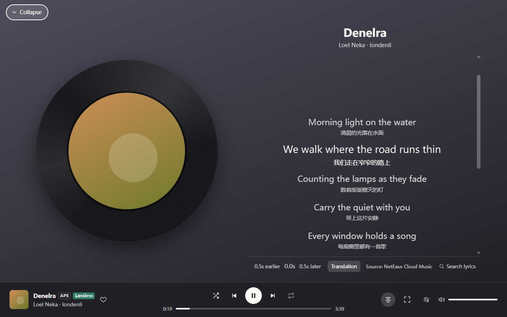
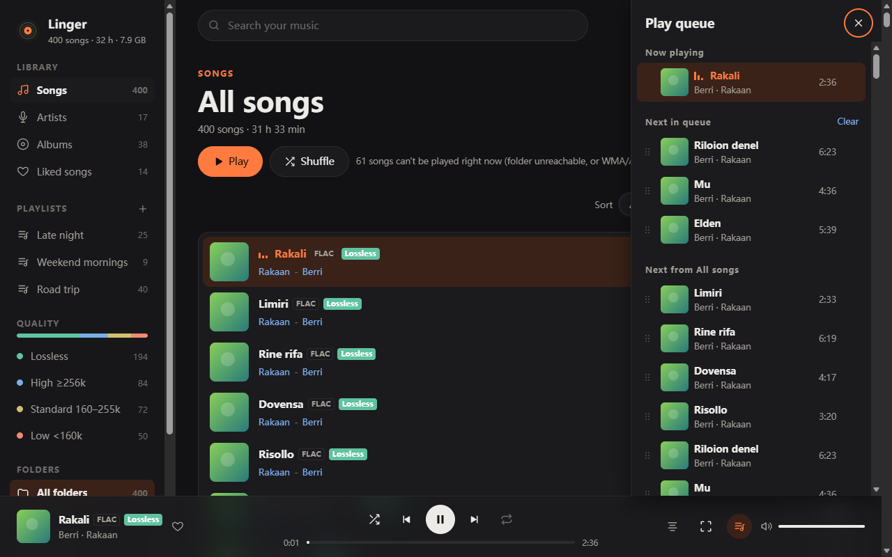
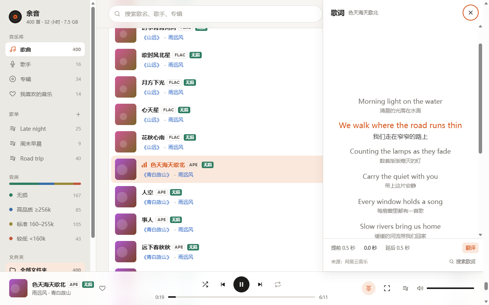

# Linger · 余音

An ad-free local music player for Windows: play your own music from local disks or NAS, with playlists, favorites and synced lyrics.

无广告的本地音乐播放器，播放电脑或 NAS 上的音乐，支持歌单、收藏和滚动歌词。

> Status: preview. Windows 10/11. 预览版，支持 Windows 10/11。

## Screenshots / 截图



| Library and play queue / 音乐库和播放队列 | Chinese interface with lyrics / 中文界面和歌词 |
|---|---|
|  |  |

Screenshots use made-up demo songs. / 截图中的歌曲均为虚构示例。

## Download / 下载

**[Download Linger-Setup.exe / 下载安装包](https://github.com/ewwgkki/linger/releases/latest/download/Linger-Setup.exe)** · [All releases / 所有版本](https://github.com/ewwgkki/linger/releases)

Run the installer and choose a folder. No administrator rights are needed, and WMA, APE and Opus support is included. The app is not code-signed yet, so Windows may show "Windows protected your PC". Choose **More info**, then **Run anyway**.

运行安装包并选择安装位置，无需管理员权限，已内置 WMA、APE、Opus 播放支持。程序暂未签名，Windows 可能提示“已保护你的电脑”，点 **更多信息**，再点 **仍要运行**。

## Features / 功能

- Play music from local disks, mapped drives and network (UNC) folders / 播放本地硬盘、映射盘和网络路径上的音乐
- MP3, FLAC, M4A, WAV, OGG, WMA, APE and Opus; CUE sheets are split into tracks / 支持常见格式，CUE 整轨自动分轨
- Browse by song, artist, album, folder and quality / 按歌曲、歌手、专辑、文件夹和音质浏览
- Playlists, favorites and a play queue / 歌单、我喜欢的音乐、播放队列
- Import Spotify playlists from Exportify or Spotify data exports / 从 Exportify 或 Spotify 数据导出导入歌单
- Synced karaoke-style lyrics and a full-screen play page / 卡拉 OK 式滚动歌词和全屏播放页
- Lyrics from embedded tags, `.lrc` files, LRCLIB and NetEase / 歌词来自内嵌标签、`.lrc`、LRCLIB 和网易云
- English and Simplified Chinese, switchable in Settings / 支持英文和简体中文，可在设置中切换
- No ads, no accounts, and your music files are never modified / 无广告、无需账号、绝不修改音乐文件

Online lyric lookups send only the song title, artist, album and duration. NetEase can be turned off in settings.

在线查歌词只发送歌名、歌手、专辑和时长。网易云来源可在设置中关闭。

## Build from source / 从源码构建

Requirements / 依赖:

1. Rust (via [rustup](https://rustup.rs/)), MSVC toolchain: `rustup default stable-x86_64-pc-windows-msvc`
2. Visual Studio 2022 Build Tools with the "Desktop development with C++" workload
3. Tauri CLI: `cargo install tauri-cli --version "^2" --locked`
4. WebView2 (preinstalled on Windows 10/11)

```powershell
git clone https://github.com/ewwgkki/linger.git
cd linger
cargo tauri dev      # run in development
cargo tauri build    # build the release
```

## License / 许可证

GPL-3.0-or-later — see [LICENSE](LICENSE) / 见 [LICENSE](LICENSE)

The installer includes FFmpeg under the LGPL, see [third-party notices](THIRD-PARTY-NOTICES.md). / 安装包内含 FFmpeg（LGPL），详见[第三方声明](THIRD-PARTY-NOTICES.md)。
