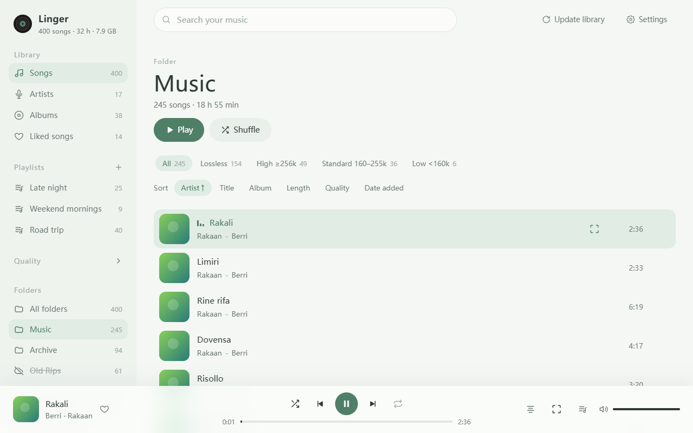
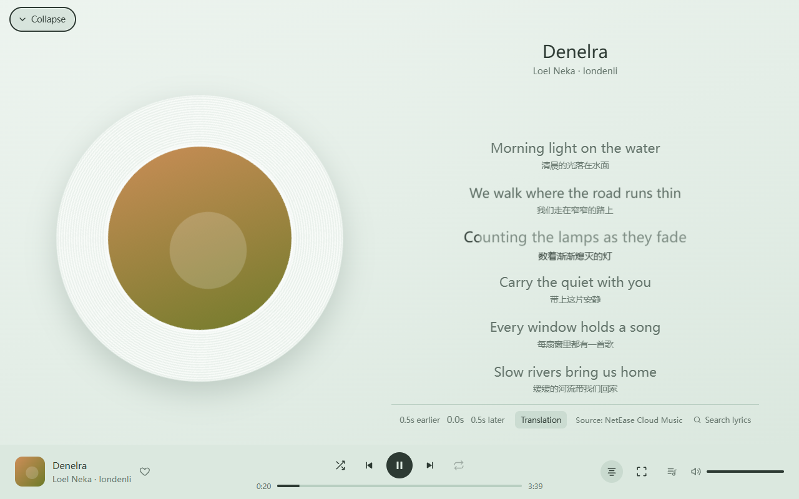
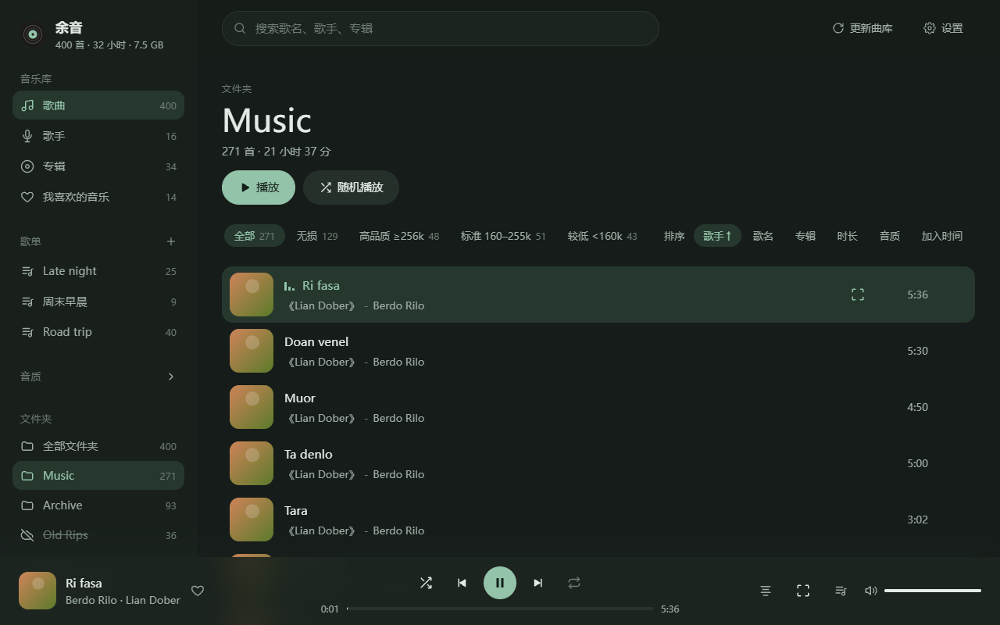
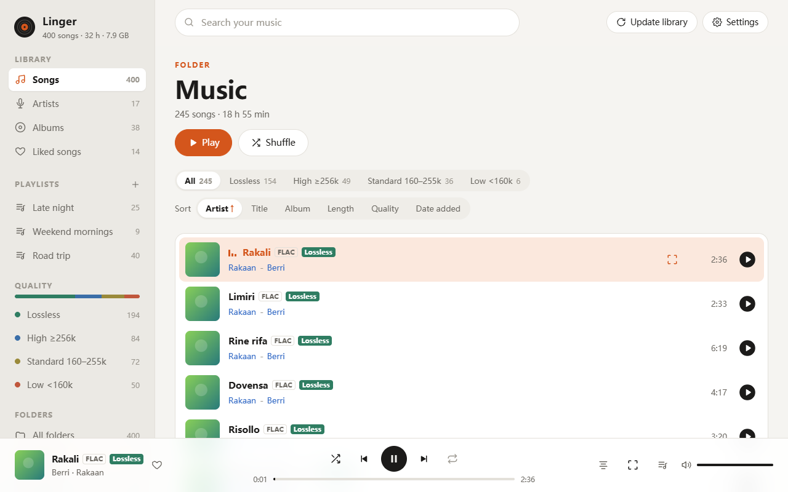

<p align="center">
  
</p>

<h1 align="center">Linger · 余音</h1>

<p align="center">
  <b>Your music, your files, nothing in the way.</b><br>
  <b>你的音乐，你的文件，没有多余打扰。</b>
</p>

<p align="center">
  An ad-free, account-free music player for Windows that plays your own collection from local disks and NAS.<br>
  无广告、免账号的 Windows 本地音乐播放器，播放你存在电脑和 NAS 上的音乐。
</p>

<p align="center">
  <a href="https://github.com/ewwgkki/linger/releases/latest/download/Linger-Setup.exe"><b>Download for Windows / 下载安装包</b></a>
  ·
  <a href="https://github.com/ewwgkki/linger/releases">All releases / 所有版本</a>
  ·
  <a href="#english">English</a>
  ·
  <a href="#中文">中文</a>
</p>

<p align="center">
  
  
  
</p>



**Lyrics that follow the song / 跟着歌曲走的歌词**



**Dark mode that follows Windows / 跟随 Windows 的深色模式**



**Classic theme / 经典主题**



Screenshots use made-up demo songs. / 截图中的歌曲均为虚构示例。

---

## English

> **Status:** preview, for Windows 10 and 11.

### Why Linger

- **Your files stay untouched.** Linger reads your music and never writes to your music folders. Its library, playlists and settings live in its own data folder.
- **Built for NAS collections.** Add local disks, mapped drives or network paths such as `\\NAS\music`. If a NAS goes offline, your songs and playlists are kept and come back when it does.
- **Lyrics that actually scroll.** Linger looks for timed lyrics first, including word-by-word lyrics, and can upgrade plain text to a timed version of the same song.
- **Messy file names are handled.** It reads both `Artist - Title` and `Title - Artist`, and you can swap them for any song in one click.
- **No ads, no account, no tracking.** There is no analytics or telemetry. The only network requests are the lyric lookups and update checks described under [Privacy](#privacy).
- **Feels like a real desktop app.** Media keys, the Windows media overlay, the system tray, in-app updates and picking up where you left off all work out of the box.

### Features

**Library**

- Plays MP3, FLAC, M4A, AAC, WAV, OGG, Opus, WMA, APE and MP2.
- Splits CUE sheets into individual tracks.
- Browse by song, artist, album, folder and quality, with instant search.
- Reads tags and file names, and detects which naming style each folder uses.

**Playlists**

- Playlists, Liked Songs and a play queue with Play next and drag-to-reorder.
- Import Spotify playlists from Exportify or a Spotify data export, with a report of any songs not found.
- Export playlists and Liked Songs as standard M3U8 files.

**Lyrics**

- Synced line-by-line and karaoke-style word-by-word lyrics, with a full-screen play page.
- Sources: embedded tags, `.lrc` files beside the song, LRCLIB and NetEase Cloud Music.
- Translations when the source provides them.
- Manual search with timed results first, or pick your own `.lrc` file. Your choice is remembered.
- Adjust timing in 0.5 second steps when a lyric runs early or late.

**Playback**

- Short fades when pausing, resuming, skipping and seeking, so the sound never cuts abruptly.
- Optional Volume balance keeps songs at a similar loudness without changing your files.
- Reopens with your last song, position and queue, paused and ready.
- Keeps playing in the system tray after you close the window.
- Works with keyboard media keys and the Windows media overlay.

**Look and feel**

- Two themes, Classic and Fresh, each with light and dark modes that follow Windows.
- English and Simplified Chinese, chosen during installation or in Settings.
- Shortcuts: `L` lyrics, `Q` queue, `/` search, `Ctrl+A` select all, `Esc` close.

### Install

1. [Download Linger-Setup.exe](https://github.com/ewwgkki/linger/releases/latest/download/Linger-Setup.exe).
2. Run it, then choose a language and an install folder. No administrator rights are needed.
3. Open Linger and add your music folders.

WMA, APE and Opus support is included. The app is not code-signed yet, so Windows may show "Windows protected your PC". Choose **More info**, then **Run anyway**.

Later updates install from **Settings > About**. Linger tells you when a new version is available and never installs it without your click.

### Privacy

- Online lyric lookups send only the song title, artist, album and duration, to LRCLIB and NetEase Cloud Music. NetEase can be turned off in Settings.
- Update checks contact GitHub. Automatic checks can be turned off in Settings.
- Your file paths, library and listening history are not uploaded.

---

## 中文

> **状态：** 预览版，支持 Windows 10 和 11。

### 为什么选择 Linger

- **绝不改动你的文件。** Linger 只读取音乐，从不写入音乐文件夹。曲库、歌单和设置都保存在它自己的数据目录。
- **为 NAS 曲库而生。** 支持本地硬盘、映射盘和 `\\NAS\music` 这样的网络路径。NAS 暂时离线时，歌曲和歌单都会保留，恢复后继续使用。
- **歌词真的会滚动。** 优先查找带时间的歌词，包括逐字歌词。已有纯文本歌词时，还能自动换成同一首歌的滚动版本。
- **文件名乱也不怕。** 自动识别“歌手 - 歌名”和“歌名 - 歌手”，个别歌曲也能一键对调。
- **无广告、无账号、不追踪。** 没有任何统计或遥测。联网只用于查歌词和检查更新，详见[隐私](#隐私)。
- **真正的桌面体验。** 媒体键、Windows 播放浮层、系统托盘、应用内更新、记住上次播放，开箱即用。

### 功能

**曲库**

- 支持 MP3、FLAC、M4A、AAC、WAV、OGG、Opus、WMA、APE 和 MP2。
- CUE 整轨自动分轨。
- 按歌曲、歌手、专辑、文件夹和音质浏览，搜索即时出结果。
- 读取标签和文件名，并自动判断每个文件夹的命名方式。

**歌单**

- 歌单、我喜欢的音乐和播放队列，支持下一首播放和拖动排序。
- 从 Exportify 或 Spotify 数据导出导入歌单，并列出没有匹配到的歌曲。
- 将歌单和我喜欢的音乐导出为标准 M3U8 文件。

**歌词**

- 逐行滚动和卡拉 OK 式逐字歌词，配有全屏播放页。
- 歌词来源：内嵌标签、歌曲旁的 `.lrc` 文件、LRCLIB 和网易云音乐。
- 来源提供翻译时可显示翻译。
- 可手动搜索，带时间的结果排在最前，也可选择自己的 `.lrc` 文件，选择会被记住。
- 歌词快了或慢了，可以按 0.5 秒微调。

**播放**

- 暂停、继续、切歌和拖动进度时有短淡变，声音不再生硬中断。
- 可选音量均衡，让不同歌曲音量更接近，不修改音乐文件。
- 重新打开时回到上次的歌曲、进度和队列，并保持暂停。
- 关闭窗口后可在系统托盘继续播放。
- 支持键盘媒体键和 Windows 系统播放浮层。

**外观与体验**

- 经典和小清新两种主题，都有跟随 Windows 的浅色和深色模式。
- 支持英文和简体中文，可在安装时或设置中选择。
- 快捷键：`L` 歌词，`Q` 队列，`/` 搜索，`Ctrl+A` 全选，`Esc` 关闭。

### 安装

1. [下载 Linger-Setup.exe](https://github.com/ewwgkki/linger/releases/latest/download/Linger-Setup.exe)。
2. 运行安装包，选择语言和安装位置，无需管理员权限。
3. 打开 Linger，添加你的音乐文件夹。

已内置 WMA、APE、Opus 播放支持。程序暂未签名，Windows 可能提示“已保护你的电脑”，点 **更多信息**，再点 **仍要运行**。

之后可在 **设置 → 关于** 中更新。发现新版本时 Linger 会提示你，只有你点击后才会安装。

### 隐私

- 在线查歌词只向 LRCLIB 和网易云音乐发送歌名、歌手、专辑和时长。网易云来源可在设置中关闭。
- 检查更新时会访问 GitHub，自动检查可在设置中关闭。
- 不会上传你的文件路径、曲库或听歌记录。

---

## Build from source / 从源码构建

Requirements / 依赖:

1. Rust (via [rustup](https://rustup.rs/)), MSVC toolchain: `rustup default stable-x86_64-pc-windows-msvc`
2. Visual Studio 2022 Build Tools with the "Desktop development with C++" workload
3. Tauri CLI: `cargo install tauri-cli --version "^2" --locked`
4. WebView2 (preinstalled on Windows 10/11)

```powershell
git clone https://github.com/ewwgkki/linger.git
cd linger
cargo tauri dev      # run in development
cargo tauri build    # build the release
```

## License / 许可证

GPL-3.0-or-later. See [LICENSE](LICENSE). / 详见 [LICENSE](LICENSE)。

The installer includes FFmpeg under the LGPL, see [third-party notices](THIRD-PARTY-NOTICES.md). / 安装包内含 FFmpeg（LGPL），详见[第三方声明](THIRD-PARTY-NOTICES.md)。
